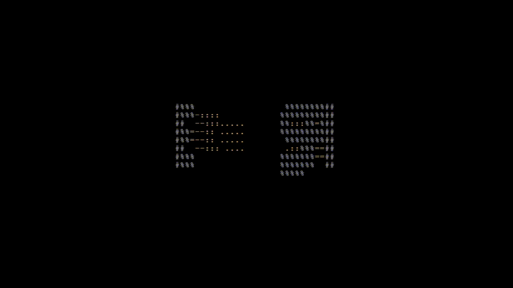

## spin name

3D ASCII rotating logo for your terminal

built with vibecoding(gemini 3.8 flash)


## DEMO




## configuration

you can customize colors, speed, fps, and characters of your rotating title

### when does the config appear?
the config file **is automatically created** when you run spin-name first time. it generates itself at: '~/.config/spin-name/config.json'

## Installation on Arch Linux

Since AUR new account registration is temporarily closed, you can install `spin-name` manually using `makepkg`:

```bash
git clone [https://github.com/aviTUPOI/spin-name.git](https://github.com/aviTUPOI/spin-name.git)
cd spin-name
makepkg -si
